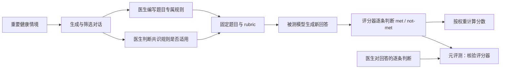

# HealthBench：沿三条主线读懂评测

[返回学习目录](../../README.md) · [学习进度](../../PROGRESS.md)

HealthBench 把医疗对话质量拆成可以逐条判断的要求。理解它的关键，是分清楚**题目、评分规则、模型回答和评分器**分别如何产生。

这里的两类医生判断作用不同：**选择共识规则是否适用于题目**发生在数据建设阶段；**判断回答有没有满足规则**用于回答评分和评分器元评测。

## 阅读顺序

| 主线 | 这篇笔记回答什么 |
|---|---|
| [01 题目生成](01-question-generation.md) | 医生做了什么？七个主题从哪里来？情境种子怎样变成对话？筛选模型筛什么？ |
| [02 Rubric 构建](02-rubric-construction.md) | 每题自己的规则与共识规则有什么关系？“超过半数且至少两人同意”同意的是什么？Theme 和 axis 有什么区别？ |
| [03 实际评价](03-evaluation.md) | met/not-met 怎样变成分数？负权重怎样计算？医生基线、Macro F1、可靠性和长度控制各在测什么？ |

## 用原题核对理解

- [04 真实题目与评分条目](04-real-examples.md)：9 道重点题，包含题干、中文讲解、英文原文和完整 rubric。
- [05 提示词与原文索引](05-prompts-and-sources.md)：筛选提示词、情境种子、医生回答指令、AI 评分器指令及论文定位。
- [42 道样题 JSON](../../assets/healthbench/examples-42.json) · [离线题库 HTML](../../assets/healthbench/question-bank.html) · [官方评分代码节选](../../assets/healthbench/grader-code-excerpt.md)。HTML 下载后可在浏览器打开。

样题编号对应所选官方 JSONL 文件的原始行号，不是论文中的题号；42 道题是供阅读使用的选样，不代表随机抽样或完整评测集。讲解中的假设回答和分数会明确标注。

## 原始出处

- [HealthBench 论文](https://cdn.openai.com/pdf/bd7a39d5-9e9f-47b3-903c-8b847ca650c7/healthbench_paper.pdf)
- [官方 simple-evals 仓库](https://github.com/openai/simple-evals)
- [所用完整题库版本：2025-05-07](https://openaipublic.blob.core.windows.net/simple-evals/healthbench/2025-05-07-06-14-12_oss_eval.jsonl)
- [来源和许可说明](../../SOURCES.md#healthbench)

笔记保留论文未披露的细节和样题自身的疑点；这里呈现的是对评测设计的学习记录。
