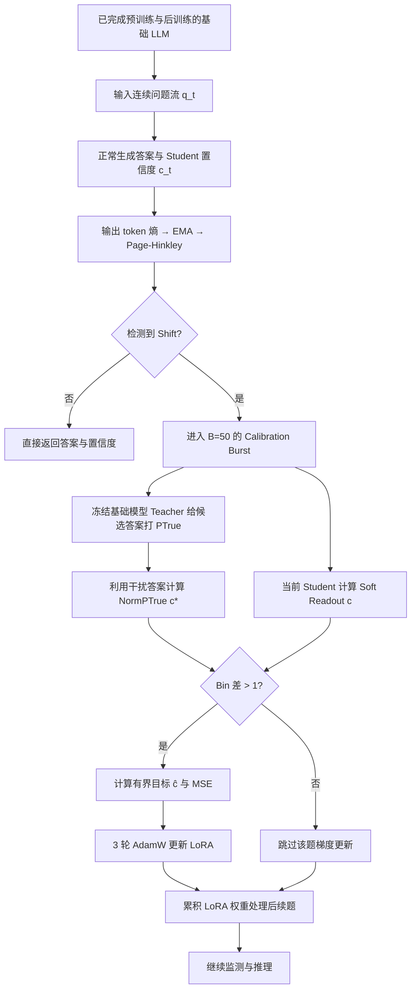

# SECL 学习笔记：按实验流程理解 LLM 置信度校准

> 论文：**Self-Calibrating Language Models via Test-Time Discriminative Distillation**（Hedna, Strich, Semmann, Biemann，2026，arXiv:2604.09624v1）<br>
> 阅读版本：[25 页预印本 arXiv:2604.09624v1](https://arxiv.org/pdf/2604.09624v1)。<br>
> 组织方式：**背景 → 基础模型 → 实验准备 → 逐题推理 → 分布变化检测 → Teacher 打分 → Student 输出 → Bin-gate → LoRA 训练 → 验证与消融**。<br>
> 标记：**[论文]** 为论文给出的设计/结果；**[基础知识]** 为帮助理解的通用原理；**[待核实]** 为论文表述不清或需要代码确认之处。文中示例数值如无特别说明，均为教学示例。这是一份论文阅读笔记，不是独立实验复现报告。

[返回学习目录](../../README.md) · [先读论文概览](overview.md)

## 0. 一张总流程图



**研究目的：** 在没有人工正确性标签的测试阶段，利用冻结基础模型的判别式正确性评分，持续改善模型**报告的置信度**（calibration），尽量减少每道题反复计算判别分数的成本。[论文 §1、§3，pp.1–5](https://arxiv.org/pdf/2604.09624v1#page=1)

---

## 1. 为什么要做这项实验：Accuracy 和 Calibration 是两回事

- **Accuracy（准确率）**：模型答对的题占多少。
- **Calibration（校准）**：一组被模型报告为约 80% 置信度的答案，实际正确率是否也约 80%。
- **Discrimination（区分能力）**：模型能否给正确答案比错误答案更高的置信度；主要用 AUROC 观察。
- **Overconfidence（过度自信）**：例如一批回答平均置信度 90%，但实际只答对 30%。

[论文] 引言引用医疗 LLM 综述：519 项研究中约 95.4% 报告 accuracy，约 1.2% 涉及 calibration/uncertainty。论文用医疗场景说明校准的重要性，但 **SECL 主实验并未使用临床数据**，使用的是一般推理/知识 benchmark。[论文 pp.1、5、9](https://arxiv.org/pdf/2604.09624v1#page=1)

### 先前方法的局限

| 方法 | 基本操作 | 作者指出的局限 |
|---|---|---|
| Sampling-based consistency | 对一题多次采样，检查答案是否一致 | 计算贵；**consistent hallucination**（多次稳定输出同一个错误答案）可能被误认为可信 |
| Static probing | 从固定模型的 hidden states 提取特征，训练探针判断正确性/幻觉 | 输入分布变化后，探针可能性能下降 |
| Training-based calibration | 用有标签数据或 RL 等方法优化置信度 | 需要标签，或在 OOD 数据上退化 |
| SECL | 分布变化时，用冻结模型的 NormPTrue 自监督地更新 LoRA | 旨在降低成本，同时无需测试集真值参与训练 |

**Distribution shift**：训练/校准与部署的数据统计分布发生变化。**OOD（Out-of-Distribution）**：测试样本来自不同于已有训练/校准分布的环境；*degrade OOD* 表示在这种环境里性能下降。[基础知识] 两者相关，但并不等同于所有分布变化都会使模型失败。

**Consistent hallucination 示例**：五次问“澳大利亚首都是哪里”，五次都错误回答 Sydney；采样一致性高，事实正确性却低。故 `P(生成答案一致)` 不等于 `P(答案正确)`。

---

## 2. 模型为什么能回答问题：预训练 → 后训练 → 冻结 → 推理

### 2.1 训练期间

1. **Tokenizer**：将文本拆成 token IDs；一个词可能由多个 token 组成。
2. **Embedding**：把 token ID 查表变成向量，例如每个 token 是 **3072 维**（此数字对应 Llama 3.2-3B）。
3. **Transformer Blocks**：多层 Attention + MLP 处理上下文，每层产生新的 hidden states。
4. **LM Head**：把最后位置的 hidden state 投影为**整个词表**各候选 token 的 logits。
5. **Softmax**：将 logits 转换成概率。
6. **Loss**：与预训练目标 token 或后训练目标比较。
7. **Backpropagation + Optimizer**：按梯度更新可训练权重。

```text
Token IDs → Embedding → Transformer × L → Hidden States
                               ↓
                        LM Head → Logits → Softmax → P(next token)
                                                  ↓
                                              Loss（训练时）
                                                  ↓
                                            Backward → 更新参数
```

**预训练**已经可能学到事实、语言规律和一定问答能力；**SFT/偏好后训练**进一步改善对话、指令遵循和回答行为。模型部署进行普通推理时，通常**权重冻结、只做 Forward**；但每次输入的 hidden states、logits 仍会重新计算。[基础知识]

### 2.2 向量、Hidden State 和 Logits 的区别

- **3072 维向量**是一串 3072 个数字，仍具有数学上的方向和长度。高维空间无法直观画出来，但可以计算点积、范数与余弦相似度。
- **Embedding** 是 token 初始向量；**Hidden State** 是特定层、特定上下文下的中间向量，因上下文和层而变化。
- 向量的某一维**通常不对应单一明确语义**；语义特征可能分布在多个维度/方向中。
- **Logits** 是 LM Head 对词表每个候选 token 输出的原始分数，可正可负，并非概率。
- 若词表有 `V` 个 token，Hidden Size 为 `d`，则一个位置的隐藏向量 `h∈R^d` 经 `W_out∈R^(V×d)` 得到 `z∈R^V`。词表规模与 hidden size 是两个不同维度。

$$
P(t_i)=\frac{\exp(z_i)}{\sum_j\exp(z_j)}
$$

[基础知识] 获取某个 token 的 logit：在**指定输出位置**查看模型输出的 `logits[..., token_id]`；token ID 由**对应模型 tokenizer**决定。`True` 与 ` True` 可能是不同 token，读取之前必须检查 tokenizer；封闭 API 不一定允许读取所有 logits。

### 2.3 Attention 的 Q、K、V、O 如何连接 3072 维

以 Llama 3.2-3B 的论文相关模型配置为例：hidden size 3072；28 个 Transformer blocks；24 个 Query/Attention Heads；8 个 KV Heads；每 Head 128 维。这里 `3072 = 24 × 128`。

| 结构 | 直觉 | 实际计算角色 |
|---|---|---|
| **Q / Query** | 当前 token“想查询什么” | 用于与各允许位置的 Key 计算匹配分数 |
| **K / Key** | 当前 token“怎样被匹配” | 与 Query 点积产生 attention scores |
| **V / Value** | 当前 token“提供什么信息” | 根据 attention weights 被加权求和 |
| **O / Output projection** | 整合多头结果 | 将拼接后的 head 输出映射回隐藏空间 |

对单个 Head：

$$
\operatorname{Attention}(Q,K,V)=\operatorname{softmax}\left(\frac{QK^\top}{\sqrt{d_k}}\right)V
$$

一个 Query 与一个 Key 的 **128 个分量逐项相乘再求和**，得到一个匹配分数；对所有允许关注的位置计算分数并 softmax，得到权重，然后**把所有允许位置的 V 加权求和**。不同 Attention Heads 通常会产生不同的权重分布。Q、K、V 代表的具体语义是训练学出来的，不是人为预设的词义字段。

**Query Head ≠ 单个 Q 向量**：一个 Head 是计算通道；该通道会为每个 token 生成自己的 Q 向量。实际实现中多个 Q 投影通常合并成一个大矩阵后 reshape。Llama 的 **GQA** 让 24 个 Query Heads 每 3 个共享一组 K/V（共 8 组），以减少 KV Cache 占用；共享 K/V 不意味着共享 Attention Weight。

**MLP/FFN**：Attention 后对每个位置的表示进一步做非线性变换；Llama 中常见 `gate_proj`、`up_proj`、`down_proj` 的 SwiGLU 结构。MLP 也通过训练获得权重，但不直接像 Attention 那样进行跨 token 的 QK 匹配。

### 2.4 层数、Head 数、3072 是怎么定的

[基础知识] 层数（深度）、隐藏维度（宽度）、Head 数与维度是**训练前由架构设计者选择的超参数**，根据算力、性能实验、硬件效率和预算折衷；不是训练过程中自动决定的。扩大 hidden size 会显著增加多个矩阵的参数量，增加 Head 数在总投影维度固定时不一定同等幅度增加参数。

---

## 3. 实验数据、模型和对照组先准备好

### 3.1 数据顺序：制造连续领域切换

[论文 §4.1，p.5](https://arxiv.org/pdf/2604.09624v1#page=5) 每个数据集取 500 题，按以下顺序组成 2,000 题的数据流：

`GSM8K（数学） → MMLU（综合知识） → ARC-Challenge（科学） → TruthfulQA（真实性/误解）`

选择题直接取其他选项作为 distractors；开放题另生成 4 个可信的干扰答案。实验中的 **distribution shift** 主要来自这些领域依次切换，而非随机现实流量。

### 3.2 模型

Llama 3.2-3B-Instruct、Llama 3.1-8B-Instruct、Gemma 2-2B-IT、Phi 3.5-Mini-Instruct。附录另用 Qwen 2.5-3B-Instruct 作为负对照。[论文 §4.1、Appendix N](https://arxiv.org/pdf/2604.09624v1#page=20)

### 3.3 Baselines（对照基线）

- **Verbalized**：只用模型自己报告的置信度，按后文 Soft Readout 计算，不额外做校准训练；“zero-cost”指**没有额外的校准处理开销**，不代表生成答案零成本。
- **P(True) Norm**：每题用冻结模型计算原答案 + 4 个 distractors 的判别评分，再归一化后直接当作置信度；**额外 5 次判别 Forward**，不更新权重。
- **SECL**：只在触发时计算 Teacher 分数、训练 LoRA，之后可更便宜地直接输出 Student 置信度。

[论文] 把 NormPTrue 视为“upper-bound reference for signal quality”，这是**高质量监督参照**，并非严格数学上界。SECL 的 ECE 可以低于它，但 AUROC/Brier 未必也更好。

---

## 4. 一道题进入模型：Student 如何生成答案与置信度

### 4.1 生成答案

输入问题 `q_i`，现有 Student（基础模型 + 已累积 LoRA）生成答案 `a_i`。普通自回归生成每一步由最后位置 hidden state 经 LM Head 产生 logits，并按 greedy / temperature sampling / top-k 等策略选下一个 token。

**Temperature 与 Top-k 不同**：

- `top-k` 限制采样候选 token 的数量。
- 生成 temperature `T` 改变 logits softmax 的概率集中程度：`P_i ∝ exp(z_i/T)`。
- `T→0` 时近似最高 logit token；`T>1` 时分布更平坦。
- 不要把**生成 temperature**与后文 NormPTrue 的归一化温度 `τ` 混淆。

### 4.2 Bin（置信度分箱）和 Verbalized Confidence

[论文 Eq.2，§3.2，pp.4–5](https://arxiv.org/pdf/2604.09624v1#page=4) Prompt 要求模型同时报告一个 **0–9** 的置信度等级，而非直接输出 `85%`。每个 bin 对应 10 个百分点区间，bin 7 表示 70%–80%，用中点 75% 代表。

| bin | 区间 | 中点 |
|---:|---|---:|
| 0 | 0–10% | 5% |
| 1 | 10–20% | 15% |
| 2 | 20–30% | 25% |
| 3 | 30–40% | 35% |
| 4 | 40–50% | 45% |
| 5 | 50–60% | 55% |
| 6 | 60–70% | 65% |
| 7 | 70–80% | 75% |
| 8 | 80–90% | 85% |
| 9 | 90–100% | 95% |

**Hard readout**：只取最高概率的 bin（argmax）。<br>
**Soft readout**：读取数字 0–9 对应 token 的概率，对各 bin 中点求加权平均：

$$
c_i=\sum_{k=0}^{9}P(\operatorname{bin}_k)\frac{k+0.5}{10}
$$

例如 bin 7 的概率 40%、bin 8 的概率 60%，则 `c=0.4×0.75 + 0.6×0.85 = 0.81`。这比直接 argmax 输出 85% 更连续，并能沿 logits 反向传播（可微分）。

**[待核实]** 论文 Eq.2 未在文字中充分明确：是否在十个数字 token 之间额外归一化；仅从整个词表 softmax 取十个 token 的概率，十者未必和为 1，具体实现尚需对照代码确认。

---

## 5. Entropy Gate：什么时候启动校准训练

[论文 §3.1，pp.4–5](https://arxiv.org/pdf/2604.09624v1#page=4) SECL 不对每道题都做昂贵的 Teacher 评分与 LoRA 更新，先监测输出 token 概率分布的熵：

$$
H_t=-\sum_j p_{tj}\log p_{tj}
$$

- **低熵**：概率集中在少数 token；**高熵**：概率更分散。
- 熵体现输出分布的不确定程度，**不等于答案正确概率**；模型可能低熵却错误。
- **EMA（指数移动平均）** 平滑熵的波动：`EMA_t = α_ema H_t + (1−α_ema) EMA_(t−1)`；论文取 `α_ema=0.05`。
- **Page-Hinkley（PH）** 累积相对参考均值的偏差，并据阈值判定变化。它不是“再平滑一次”，也不是求均值的一阶导数。

论文 Eq.1 写为：

$$
m_t=\sum_{s=1}^{t}(H_s-\bar H_t-\epsilon)
$$

警报条件：

$$
m_t-\min_{s\leq t}m_s>\lambda
$$

论文设置 `ε=0.05`、`λ=3.0`，先 warmup 30 题。较大 `λ` 会要求更大的累积偏差才触发。[论文 Appendix C](https://arxiv.org/pdf/2604.09624v1#page=13)

**[待核实]** 正文同时提 EMA 与 running mean `\bar H_t`，却未充分说明二者如何精确衔接；实现应与源码比对。论文展示的 PH 触发公式主要是上升型累计变化，不能据此认定可检测所有输入 shift。

### Burst 是什么？

**Calibration Burst = 检测到 Shift 后，连续处理的一个校准窗口**。论文默认 `B=50`。这不是 50 个 epoch，也不是保证 50 题全部训练：**50 题进入窗口，每题还要经过 Bin-gate 筛选**。每次 Burst 之后，LoRA 权重不重置；以后若再次检测到变化，接着已有 LoRA 权重训练。[论文 §3.1、Figure 2](https://arxiv.org/pdf/2604.09624v1#page=4)

---

## 6. Teacher：如何为原答案和干扰答案计算 P(True)

[论文 §3.2，pp.4–5](https://arxiv.org/pdf/2604.09624v1#page=4) Teacher 使用**同一份最初的基础模型，关闭/不加载 Student 的 LoRA**，参数始终冻结。

对原问题 `q` 和每个候选答案 `x` 单独构造判别 Prompt，例如：

```text
Question: What is the capital of Australia?
Proposed answer: Sydney
Is this answer correct? (True/False)
```

模型执行 Forward 后，LM Head 在**最后一个预测位置**给词表中每个 token 分配一个 logit。通过 tokenizer 找到 `True` 的 token ID，读取该位置的概率：

$$
PTrue(x\mid q)=P(\text{下个 token = True}\mid q,x,\text{判别 prompt})
$$

- `Sydney`、`Canberra` 等都要分别运行相应 Prompt。
- 五个独立 `PTrue` **不要求和为 1**。
- 读取 logit 与读取 probability 不同；通常用 softmax 转换。
- **[待核实]** 论文未充分明确是从整个 vocabulary 概率分布直接读 `True`，还是在 `True/False` 两项之间重新归一化；需要核对代码。tokenizer 的 `True` 与带前导空格的 ` True` 也要核查。

### 为什么不直接用原始 P(True)？

**Suggestibility bias（易受暗示偏差）**：模型可能对不同候选答案都倾向回答 True。因此某个错误答案原始 PTrue 很高，不代表其真正可靠；跨领域也可能退化。

---

## 7. Distractors + NormPTrue：让各答案相对比较

[论文 Eq.3](https://arxiv.org/pdf/2604.09624v1#page=5) 选择题使用其他选项；开放题生成 `K=4` 个 plausible distractors。计算原答案 `a` 与每个干扰答案 `d_k` 的 PTrue，再按温度 `τ` 归一化：

$$
\operatorname{NormPTrue}(a)=\frac{e_a}{e_a+\sum_{k=1}^{K}e_{d_k}}
$$

**正文的写法**：

$$
e_x=\exp\left(\frac{PTrue(x)}{\tau}\right)
$$

当开放题有四个干扰答案时，这就是对五个评分做 softmax；`exp` 将分数变为正权重，再除以所有权重之和。**归一化本身并不一定要求指数化**，例如所有分数非负且总和非零，可以直接除以总和；softmax 是特定归一化形式。

- 较小 `τ` 使相对差异更尖锐；较大 `τ` 使分布更平坦。
- 论文选 `τ=0.7`（Llama 3.2-3B）、`1.5`（Gemma/Phi）、`3.0`（Llama 3.1-8B）。
- 这里的 `τ` 不控制文字生成随机性，而是**对判别分数做候选间归一化**。

### 正文与附录的公式差异

**[待核实]** [论文正文 Eq.3，第5页](https://arxiv.org/pdf/2604.09624v1#page=5) 用 `softmax(PTrue/τ)`，[附录 Q，第23页](https://arxiv.org/pdf/2604.09624v1#page=23)文字却说 `softmax(log PTrue/τ)`。两者数学上不等价：

$$
\operatorname{softmax}\left(\frac{p_i}{\tau}\right)\ne\operatorname{softmax}\left(\frac{\log p_i}{\tau}\right)
$$

若 `τ=1`，后者等于把 `p_i` 直接除以 `Σp_j`。特别是 K=4 时，按正文公式、`0≤PTrue≤1`、`τ=0.7`，即使原答案 PTrue=1 且四个 distractors PTrue=0，最高归一化值也仅约 **51.1%**。这与附录关于分数能接近 1 的解释存在张力，实际采用的版本尚需代码与实验确认，**不能擅自认定作者实际用了哪一种**。

---

## 8. Student 与 Teacher 怎么汇合：Bin-gate → Directional Target

进入 Burst 后，逐题比较：

- **Teacher：** 不带 LoRA 的冻结模型，以原答案和 distractors 计算 `c_i* = NormPTrue(a_i)`。
- **Student：** 基础模型 + 之前累积的 LoRA，按数字 token soft readout 得到 `c_i`。

### 8.1 Bin-gate

[论文 §3.3](https://arxiv.org/pdf/2604.09624v1#page=5) 当两个分数属于的置信度箱相差 **超过 1** 才训练：

$$
|\operatorname{bin}(c_i)-\operatorname{bin}(c_i^*)|>1
$$

例如 `c=0.90` 与 `c*=0.30`，分别位于 bin 9 与 bin 3，差 6，训练；若相差 ≤1 个 bin 则跳过。

### 8.2 Directional Target

论文认为 Teacher 信号仍可能对个别问题有噪声，不把 `c_i*` 直接当监督目标，而是每次只**朝它走小步**：

$$
\hat c_i=c_i+\alpha_{step}\cdot\operatorname{clip}(c_i^*-c_i,-\delta,\delta)
$$

参数 `α_step=0.5`，`δ=0.15`。例如 `c=0.90`、`c*=0.30`，差值 -0.60，被截到 -0.15，于是 `ĉ=0.90+0.5×(-0.15)=0.825`。

`0.825` 是**训练目标**，不是保证三次更新后 Student 必然输出 82.5%。`clip` 限制的是单次目标的修正幅度，**不是**对模型参数更新范数的严格约束。

### 8.3 Loss

$$
L_i=(c_i-\hat c_i)^2
$$

对 Student 中可训练 LoRA 参数求导，最小化该 MSE；Teacher 的基础权重保持冻结。**[待核实]** 实际实现里 `ĉ` 是否 `detach/stop_gradient` 应查看源码；如果目标随着 `c` 一同参与求导，梯度含义会不同。

---

## 9. LoRA：每道触发训练的题怎样更新

### 9.1 先理解 Backpropagation、Optimizer

计算图：`Hidden States → LM Head → bin logits → c → Loss`，梯度沿计算图**反向**通过链式法则传给可训练参数。PyTorch `loss.backward()` 自动求导；AdamW `optimizer.step()` 更新参数。

**链式法则**就是每段局部微分相乘，例如：

$$
\frac{\partial L}{\partial w_1}=\frac{\partial L}{\partial h_2}\frac{\partial h_2}{\partial h_1}\frac{\partial h_1}{\partial w_1}
$$

**AdamW**：常规优化器，利用一阶动量和二阶矩估计自适应更新，并将 weight decay 与梯度更新解耦。读懂和复现实验不要求手写 AdamW；需要会设置学习率、检查梯度和训练状态。

### 9.2 LoRA 的 Rank、Alpha

冻结原权重 `W`，添加可训练低秩更新：

$$
W'=W+\frac{\alpha}{r}BA
$$

- **rank `r`** 决定更新矩阵的最大秩与适配容量；不是 Transformer 层数。
- **LoRA alpha `α`** 是该分支的缩放参数（标准 LoRA 用 `α/r`）。
- SECL 取 `r=8`、`α=16`，标准缩放因子为 2。
- Rank 更大→参数更多，并不自动提升效果；Alpha 更大→更新分支的缩放更强，不能简单理解成每轮权重翻倍。
- SECL 并未充分进行 Rank × Alpha 系统性消融；这些数是选择的实现配置，而非通用最优值。

### 9.3 更新 Q、V，K/O/MLP 怎么办？

**预训练**一般会更新 Q、K、V、O、MLP 等可训练模块；**SECL** 只在指定中后层的 Q/V 投影添加 LoRA，原模型主体（包含原 Q/V）全部冻结。LoRA 也可用于 K、O、MLP；**并非只能改 Q/V**。

[论文 Appendix A/C/J](https://arxiv.org/pdf/2604.09624v1#page=13) 具体设置：

| 模型 | 适配层 | LoRA 模块 | 可训练参数 |
|---|---|---|---:|
| Llama 3.2-3B | 最后 4 层（24–27，0-based） | q_proj、v_proj | 327,680 |
| Llama 3.1-8B | 最后 8 层 | q_proj、v_proj | 1,048,576 |
| Gemma 2-2B | 最后 8 层 | q_proj、v_proj | 491,520 |
| Phi 3.5-Mini | 最后 8 层 | qkv_proj（融合） | 786,432 |

**[论文文字差异]** 正文描述可训练参数范围“328K–786K”，但 Appendix A 报告 Llama 8B 为 1,048,576，应以后者实际表项为准，不把正文范围当作覆盖全部模型的统计。

### 9.4 一题三次、一 Burst 五十题

- `B=50`：Shift 触发后，连续 **50 道题进入 Burst**。
- 对**通过 Bin-gate 的题**，执行 `3 epochs per question`，常见理解是对该题固定目标进行三轮优化。
- 一道题更新后，不恢复旧权重：**下一道题在累积 LoRA 参数上继续更新**。
- 例如 50 题中 20 题通过筛选、每题每轮一步，则大约有 `20 × 3 = 60` 个 optimizer steps（教学计数，视实际批处理实现）。
- 模型准确率可能改变：即便 Loss 只监督置信度，更新 Q/V 仍会改变 Hidden States 和答案 token 的 logits，因此不能保证模型答案完全不变。

[论文] 超参数：`AdamW; LR=5e-5; epochs/question=3; α_step=0.5; δ=0.15; r=8; LoRA α=16; EMA α=0.05; PH ε=0.05; λ=3; warmup=30; B=50`。[论文 §4.1、Appendix C](https://arxiv.org/pdf/2604.09624v1#page=13)

---

## 10. 训练完成怎么评价：四个指标

对每道题，`c_i∈[0,1]` 为预测的正确概率，`y_i=1/0` 为**评估阶段**使用的真实正确性标签（SECL 在线 LoRA 训练不使用该标签）。

| 指标 | 关注什么 | 方向 |
|---|---|---|
| **ECE** | 一个置信度区间的平均置信度与实际正确率的偏差 | 越低越好 |
| **Brier Score** | 逐题概率与 0/1 真值的平方误差；兼顾校准与区分信息 | 越低越好 |
| **AUROC** | 正确答案是否通常比错误答案获得更高置信度（排序能力） | 越高越好 |
| **Accuracy** | 任务答案是否正确，与置信度好坏分开 | 越高越好 |

论文用 10 个等宽 bin 计算 ECE：

$$
ECE=\sum_{m=1}^{10}\frac{|B_m|}{N}\left|\operatorname{acc}(B_m)-\operatorname{conf}(B_m)\right|
$$

Brier：

$$
BS=\frac1N\sum_{i=1}^{N}(c_i-y_i)^2
$$

AUROC 可直观理解为随机拿一题正确和一题错误时，正确题获得更高置信度的概率（并列需半权重）。**低 ECE 不等于高 AUROC**：模型可以接近常数地报告整体正确率，得到不错的分箱校准，却几乎无法区分哪一题会错。[论文 Appendix B/E](https://arxiv.org/pdf/2604.09624v1#page=13)

### 10.1 主结果（论文 Table 1、Appendix D）

| 模型 | Verbalized ECE | NormPTrue ECE | SECL ECE | Verbalized AUROC → SECL AUROC |
|---|---:|---:|---:|---:|
| Llama 3.2-3B | .170 | .065 | .050 | .510 → .587 |
| Llama 3.1-8B | .225 | .120 | .083 | .684 → .643 |
| Gemma 2-2B | .256 | .141 | .056 | .558 → .548 |
| Phi 3.5-Mini | .251 | .154 | .110 | .600 → .521 |

**解读：** 主要模型的 ECE 均改善；**但 Phi 和 Llama 8B 的 AUROC 下降**，Gemma 也略降。论文说 Student 超越自己的监督信号，主要依据是 **ECE**，并不意味着 Brier/AUROC 全部超过 NormPTrue。任务 Accuracy 总体变化接近 1 个百分点以内。[论文 pp.6–7](https://arxiv.org/pdf/2604.09624v1#page=6)

### 10.2 成本 FWD-eq

[论文 Appendix M](https://arxiv.org/pdf/2604.09624v1#page=19) 用 forward-pass equivalents 粗略估成本：一般生成 1 个等效 FWD；NormPTrue 需要总计约 6（1 生成 + 5 判别），SECL 因只在部分题训练，平均成本约 1.8–4.6 FWD-eq/题（不同模型）。这是一种近似，不等于实际 GPU 墙钟时间或每次访问的 token 数完全相同。

---

## 11. 消融实验：哪些部件是必要的，哪些结论还有限制

**Ablation（消融）**：固定其他条件，只移除/替换一个设计，比较指标。它能检验设计贡献，但不能凭一个指标断言普遍最优。

| 比较 | 论文观察 | 应怎样理解 |
|---|---|---|
| Entropy Gate vs Always-on | Llama 3B：ECE .050 vs .047；受训比例 25.6% vs 100% | Gate 主要节约训练成本，未显示必须靠它才能得到最低 ECE |
| Burst B=20 vs 50 | ECE .114 vs .050 | 训练窗口长度很重要，50 是测试配置而非普适最优值 |
| Accumulate vs 每题重置 LoRA | ECE .050 vs .237 | 跨题累积 LoRA 在此设置下很关键 |
| Directional target vs 直接 MSE | 约 .052 vs .085（对应消融设置） | 有界目标对噪声监督可能更稳健 |
| Teacher 改用 Self-Consistency | ECE .050 → .432 | 不好的伪标签可能被蒸馏进去并放大 |
| LoRA Early / Mid / Late | Llama 在中层和后层都有效，早层也有效 | Probe 能读出信息的位置 ≠ 最优干预位置 |
| 领域顺序正向/逆向 | 均有总体 ECE 改善，幅度不同 | 权重累积使表现受数据顺序影响 |

[论文 §4.3、Appendix G/I/J/L/Q](https://arxiv.org/pdf/2604.09624v1#page=15)

### 11.1 论文中需保留的反例

1. **Qwen 2.5-3B 负对照**：NormPTrue 最佳 ECE .257，Verbalized .247；当 Teacher 信号不优于 Student，SECL 的关键前提不成立。[Appendix N](https://arxiv.org/pdf/2604.09624v1#page=20)
2. **Phi 的 4,000 题扩展流**：Verbalized ECE .192，SECL ECE .259，反而恶化；长期连续适应并非始终有效。[Appendix R](https://arxiv.org/pdf/2604.09624v1#page=24)
3. **部分领域 ECE 反而上升**：例如正向顺序下 ARC 在多个模型上退化；总体指标会掩盖子领域损失。[Appendix H/L](https://arxiv.org/pdf/2604.09624v1#page=17)
4. **灾难性遗忘未被彻底排除**：论文比较了权重累积及任务正确率，但未提供独立、广覆盖的长期旧能力遗忘评估；“mitigates catastrophic forgetting”应看作有限证据下的解释。[§5 Limitations](https://arxiv.org/pdf/2604.09624v1#page=9)

---

## 12. 读论文时补齐的术语表

| 术语 | 一句话理解 |
|---|---|
| Tokenizer / Token ID | 将文本映射到模型词表中的 token 编号 |
| Embedding | Token ID 查表得到的初始向量 |
| Hidden State | 某一层某一位置的上下文表示向量 |
| Logit | LM Head 输出的 token 原始分数 |
| Softmax | 用指数权重将分数转为总和为 1 的概率分布 |
| Temperature | 调整 softmax 分布集中程度的参数；须区分生成 T 与归一化 τ |
| Top-k | 只在概率最高的 k 个候选 token 中抽样 |
| Q/K/V | 生成查询、匹配键、传递值的三个可训练投影结果 |
| Attention Head | 一条独立计算注意力权重和输出的通道，不等于单个 Q 向量 |
| GQA | 多个 Query Heads 共用一组 K/V Heads，降低 KV Cache 成本 |
| O Projection | 将各 Attention Head 输出整合回隐藏维度 |
| MLP | 对每个位置的特征进行非线性变换的模块 |
| Forward | 用当前参数算输出，不意味着更新参数 |
| Loss | 衡量输出与目标之间偏差的可微函数 |
| Backpropagation | 用链式法则从 Loss 反推参数梯度 |
| PyTorch Autograd | 自动微分框架，执行梯度计算 |
| AdamW | 常见自适应优化器，依据梯度更新权重 |
| LoRA | 冻结主体权重，只训练低秩增量矩阵 |
| LoRA Rank / Alpha | 增量表达容量 / 增量缩放强度 |
| Freeze | 不更新参数；仍可前向计算新的 hidden states/logits |
| Teacher / Student | 冻结基础模型输出伪标签 / 带 LoRA 模型学习改进置信度 |
| P(True) | 判别 Prompt 下一 token 为 True 的概率 |
| Distractor | 用于与原答案比较的备选答案 |
| NormPTrue | 多候选评分归一化后的原答案相对置信度 |
| Bin / Bin-gate | 10 个置信度区间 / 只更新差距超过阈值的题 |
| EMA | 对序列做指数加权平滑 |
| Page-Hinkley | 在线累积偏差，检测统计水平改变 |
| Burst | 触发 shift 后连续处理的一批校准问题 |
| TTT | 测试期间用当前输入更新部分模型参数 |
| Calibration / ECE | 概率与经验正确率是否匹配 / 分箱偏差指标 |
| Discrimination / AUROC | 能否给正确答案更高分 / 排序指标 |
| Brier | 每题概率预测的平方误差 |
| Ablation | 改一项设计，对比其影响 |
| OOD | 超出原训练/校准分布的测试环境 |
| Consistent Hallucination | 多次采样稳定地产生同一个错误答案 |
| Triton Kernel | 用 Triton 编写高性能 GPU 计算核心；本论文并不要求自行实现 Triton |

---

## 13. 原文定位索引

| 笔记主题 | 论文位置 |
|---|---|
| 动机、Calibration 和先前工作 | [Abstract / §1–2，pp.1–3](https://arxiv.org/pdf/2604.09624v1#page=1) |
| 完整流程图 | [Figure 2，p.2](https://arxiv.org/pdf/2604.09624v1#page=2) |
| EMA、Page-Hinkley、Burst | [§3.1，p.4](https://arxiv.org/pdf/2604.09624v1#page=4) |
| Soft Readout、PTrue、Distractors、NormPTrue | [§3.2，pp.4–5](https://arxiv.org/pdf/2604.09624v1#page=4) |
| Directional Target、MSE、Bin-gate、LoRA | [§3.3，p.5](https://arxiv.org/pdf/2604.09624v1#page=5) |
| 数据、模型、超参数、Baseline、Metrics | [§4.1，pp.5–6](https://arxiv.org/pdf/2604.09624v1#page=5) |
| 主实验结果 | [§4.2，Table 1，pp.6–7](https://arxiv.org/pdf/2604.09624v1#page=7) |
| 消融实验 | [§4.3，pp.7–8；Appendix G/I/J/L/Q](https://arxiv.org/pdf/2604.09624v1#page=7) |
| 指标定义与完整超参数 | [Appendix B/C，p.13](https://arxiv.org/pdf/2604.09624v1#page=13) |
| Teacher 归一化细节/数值矛盾 | [Appendix F/Q，pp.14–16、23–24](https://arxiv.org/pdf/2604.09624v1#page=14) |
| Qwen 负对照 | [Appendix N，p.20](https://arxiv.org/pdf/2604.09624v1#page=20) |
| 推理成本 | [Appendix M，p.19](https://arxiv.org/pdf/2604.09624v1#page=19) |
| 4,000 题长期实验 | [Appendix R，pp.24–25](https://arxiv.org/pdf/2604.09624v1#page=24) |

**原文局限提醒**：本文观察到的是指定模型、数据流及实验设置下的置信度校准结果；医疗风险是论文动机，不代表论文已完成临床验证。tokenizer、logit/概率归一化、EMA–PH 衔接及梯度 detach 等实现细节仍未在本笔记中完成代码核验。


[返回论文概览](overview.md) · [返回学习目录](../../README.md)
